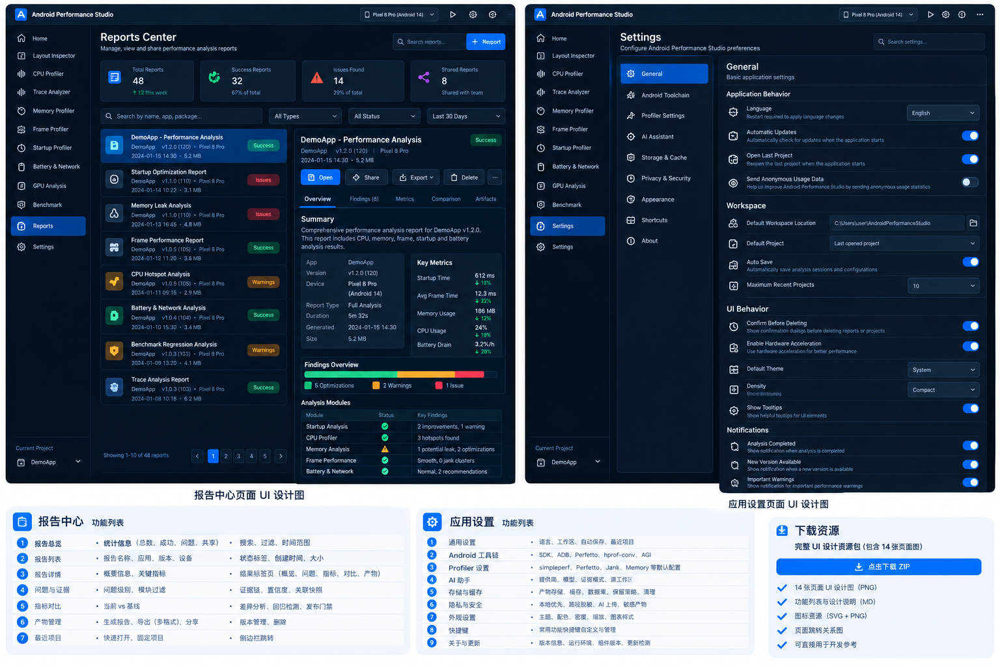
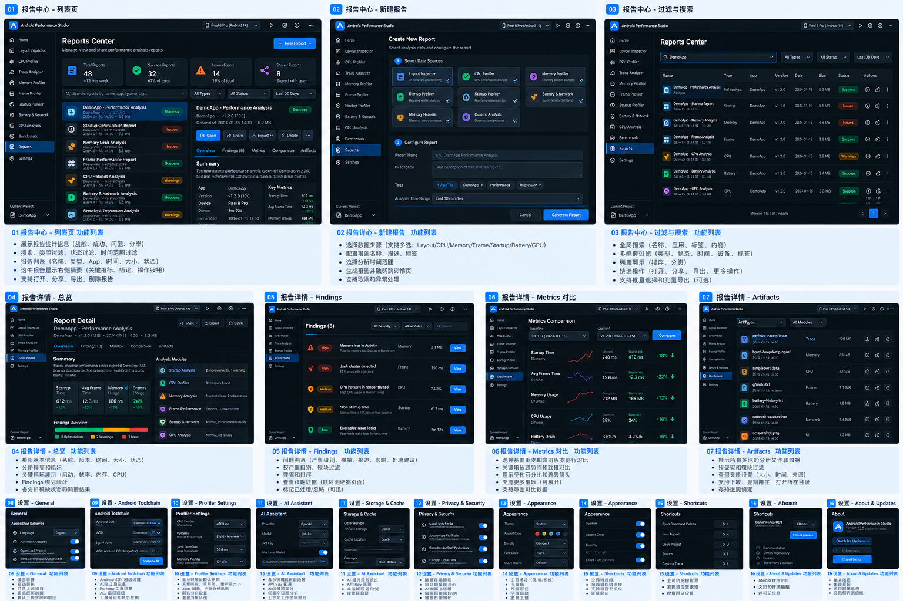

# 页面 11：Reports Center





## 16.1 为什么需要独立 Reports 页面

当前各 feature 已有不同 export 能力，但商业软件需要一个统一的：

```text
“我曾经生成了什么结果，来源是什么，能否重新打开”
```

中心。

## 16.2 Reports 不是统一业务模型

只索引：

```kotlin
data class StudioReportIndexEntry(
    val id: String,
    val feature: StudioFeature,
    val reportType: String,
    val title: String,
    val createdAt: Instant,
    val sourceArtifactIds: List<String>,
    val file: Path?,
    val format: ReportFormat,
    val warnings: List<String>,
)
```

不把不同 report 内容转换成一个通用 JSON schema。

## 16.3 页面功能

```text
Search
Feature filter
Date filter
Report type filter

Reports Table
Name | Feature | Source | Created | Format | Status

Preview/Metadata
Source artifacts
Warnings
Open
Reveal
Export Copy
Delete index entry
```

如果 report 本身是用户文件，删除 Index 默认不删除原始文件；真实删除必须明确二次确认。

---
